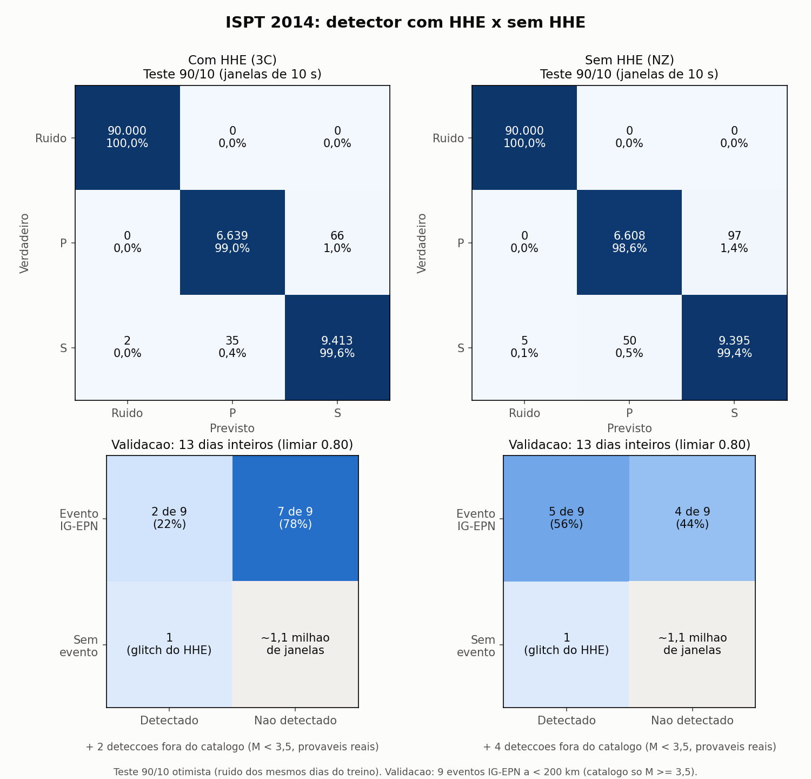
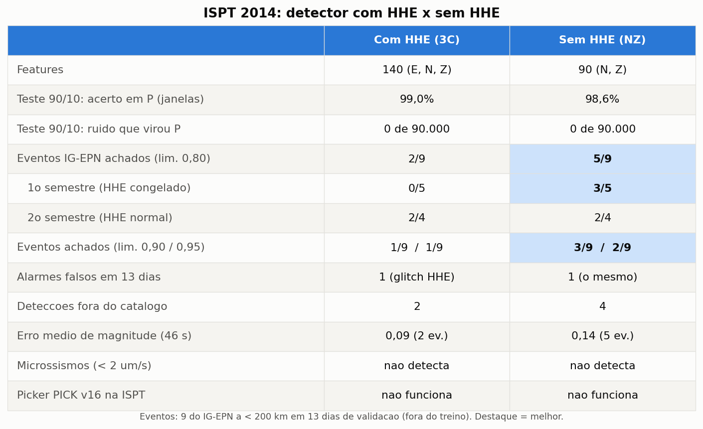
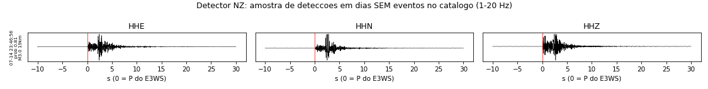
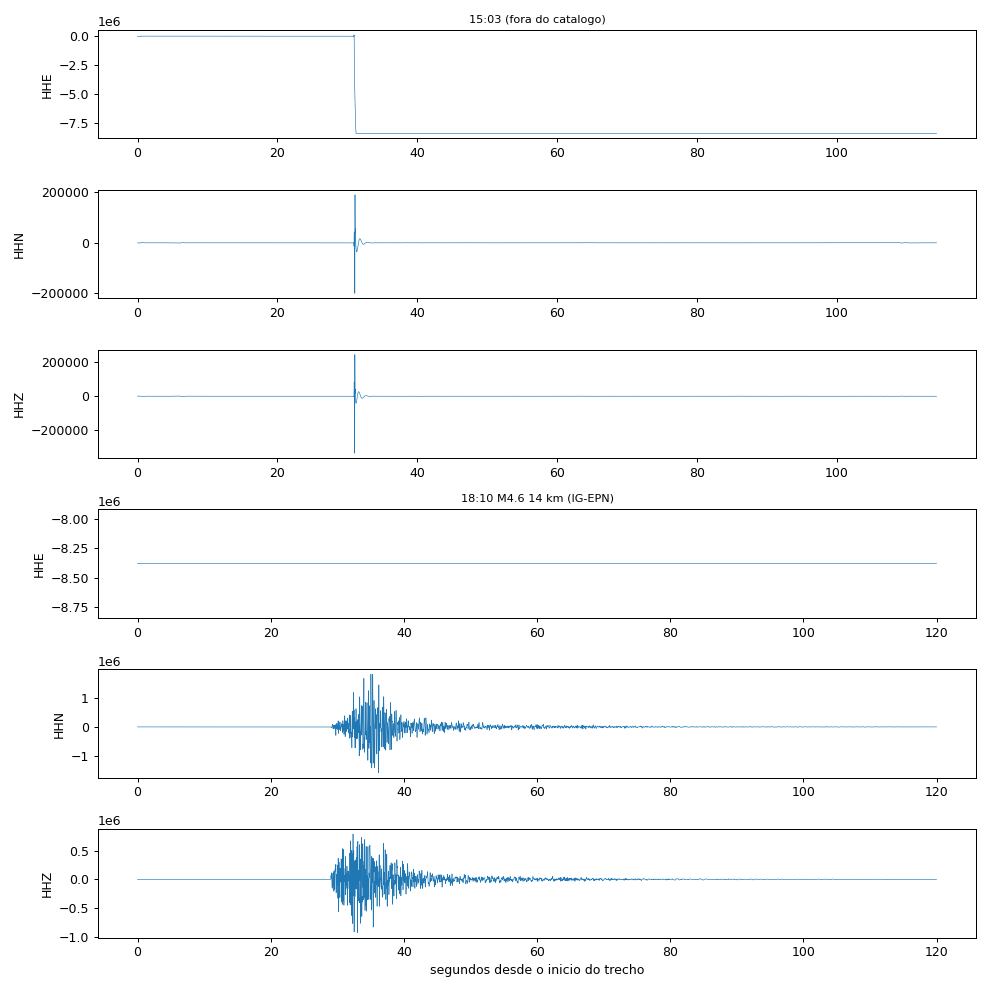

# Detector E3WS para a estação ISPT (2014): treino e validação

*Experimento 02 · Isla de la Plata, Equador · com HHE (3C) × sem HHE (NZ) · 23/11/2026*

## 1. Resumo

- Foram treinados dois detectores para a ISPT:
  - o **3C**, com os 3 componentes;
  - o **NZ**, só com N e Z.
- Os dois usaram o ruído do ano inteiro de 2014 (24 dias, ~1.029 mil janelas) e o `atr_eq` oficial.
- No teste 90/10 os dois são quase perfeitos: 0 de 90.000 janelas de ruído viraram P. Esse teste,
  porém, é otimista.
- Na validação em 13 dias inteiros fora do treino:
  - o **NZ achou 5 de 9 eventos IG-EPN**;
  - o **3C achou só 2 de 9**, e nenhum no 1º semestre, com o HHE congelado (0/5).
- Só houve 1 alarme falso em 13 dias, um glitch do HHE, e foi o mesmo nos dois detectores.
- **Proposta: usar o detector NZ em 2014.**
- Há dois problemas para discutir: o picker genérico não funciona na ISPT, e o detector não enxerga
  microssismos (seção 6).

## 2. Contexto: o canal HHE em 2014

- De 01/01 a 08/07/2014, o canal HHE da ISPT ficou congelado em −8.382.254 contagens, perto do limite
  de 24 bits, com spikes ocasionais.
- Nas janelas congeladas, as 45 features do componente E saem NaN.
- Mesmo no 1º semestre, há trechos curtos em que o canal volta a funcionar.

## 3. Treino

### 3.1 Dados

| Conjunto | Origem | Janelas |
|---|---|---|
| Terremotos (P e S) | `atr_eq` oficial do E3WS (M ≥ 3), 21.778 terremotos | 167.525 (P 70.193, S 97.332) |
| Ruído | 24 dias de 2014, 2 por mês, sorteados; 13 com HHE congelado | 1.029.441 úteis (557.944 com HHE congelado) |
| Ruído usado no modelo final | amostra do conjunto acima (baseline do Pablo) | 900.000 |

- **Janelas:** 10 s, com passo de 1 s, dados reamostrados a 100 Hz.
- **Pré-processamento:** resposta removida com o StationXML (em aceleração) e filtro de 1–7 Hz.
- **Máscara de eventos no ruído:** a do `gen_catag` (STA/LTA recursivo 60/240 s, ±60 s). Ela tirou
  só 0,5 % das janelas.
- **Dias excluídos do ruído:** os com eventos IG-EPN a < 300 km, com telessismos M ≥ 6,5 ou com
  dados incompletos.

### 3.2 Modelo

- StandardScaler + XGBoost (`gpu_hist`; 6.000 árvores, profundidade 4, taxa 0,05; os demais
  hiperparâmetros são os do E3WS).
- **3C:** 140 features (E, N, Z + 5 cruzadas), treinado em 22,8 min.
- **NZ:** 90 features (só N e Z), treinado em 11,1 min.
- Os dois treinos rodaram numa RTX 3050.

## 4. Resultados

*Figura 1. Em cima: teste 90/10 (janelas). Embaixo: validação em 13 dias inteiros (eventos). Os
verdadeiros negativos (TN) não são contados na validação, porque são dias inteiros, com ~1,1 milhão
de janelas.*

### 4.1 Teste 90/10

- 10 % dos terremotos e 90.000 janelas de ruído ficaram fora do treino.
- Os dois modelos acertam ~99 % das janelas P e S, e nenhuma janela de ruído vira P.
- O teste é **otimista**, porque o ruído do teste vem dos mesmos dias do treino.

### 4.2 Validação em dias inteiros

- **Dias:** 13 que não entraram no treino. São 6 calmos (3 deles com o HHE congelado) e 7 com
  eventos IG-EPN a < 200 km.
- **Gatilho:** igual ao do `E3WS_rt.py`. Dispara quando a média das 3 últimas prob. de P passa do
  limiar e rearma quando a média das 5 últimas prob. de ruído chega a 0,99.
- **Referência:** o catálogo IG-EPN da pasta do Pablo, que só tem M ≥ ~3,5.
- **Critério:** um evento conta como "encontrado" se a P do E3WS cai entre a origem − 5 s e a
  origem + dist/5,5 + 15 s.

| Evento IG-EPN (UTC) | M | Dist. km | Prof. km | HHE | 3C | NZ |
|---|---|---|---|---|---|---|
| 2014-01-02 08:42 | 3,9 | 148 | 8 | congelado | – | **sim (0,95)** |
| 2014-01-05 16:29 | 3,7 | 184 | 63 | congelado | – | – |
| 2014-06-13 18:10 | 4,6 | 14 | 3 | congelado | – | **sim (1,00)** |
| 2014-06-13 19:16 | 3,8 | 11 | 7 | congelado | – | **sim (0,98)** |
| 2014-07-02 16:10 | 3,6 | 151 | 9 | congelado | – | – |
| 2014-07-18 12:08 | 4,1 | 108 | 6 | normal | – | – |
| 2014-08-01 10:05 | 3,9 | 112 | 13 | normal | sim (0,84) | sim (0,87) |
| 2014-09-05 05:38 | 3,6 | 104 | 49 | normal | – | – |
| 2014-09-05 20:50 | 3,9 | 64 | 10 | normal | sim (0,99) | sim (0,87) |
| **Total** | | | | | **2/9** | **5/9** |

*Tabela 1. Eventos do catálogo nos dias de validação e prob. de P, com limiar 0,80. Os dois
detectores perderam os eventos a mais de 100 km; dois deles são profundos (49 e 63 km).*

*Figura 2. Comparação dos dois detectores.*

### 4.3 Detecções fora do catálogo e alarme falso

- **Dias calmos:** houve 1 detecção em 6 dias (14/07 23:46:56), nos dois detectores.
  - P e S estão nítidas, com S−P ≈ 2,3 s (~19 km), e o E3WS estimou M3,0.
  - É um microssismo real (Figura 3).
- **Dia 13/06, só no NZ:** detecções às 18:40 e às 18:45 (M ~3,7, 15–24 km). Parecem réplicas do
  M4,6, mas ainda não foram conferidas no sismograma.
- **Único alarme falso: 13/06 às 15:03:26, nos dois detectores.**
  - É o instante em que o HHE volta a congelar (salta para −8,38 milhões de contagens).
  - No mesmo instante aparece um pulso em N e Z.
  - É um glitch do instrumento, não um terremoto (Figura 4).

*Figura 3. Única detecção do NZ em dias calmos (1–20 Hz; 0 = P do E3WS).*

*Figura 4. Alarme falso das 15:03 (em cima) × M4,6 das 18:10 (embaixo), em 13/06/2014. O HHE está
em contagens brutas; N e Z estão filtrados em 1–20 Hz.*

### 4.4 Parâmetros de fonte (46 s de P)

| Evento | M cat. | M E3WS | Dist. cat. (km) | Dist. E3WS (km) |
|---|---|---|---|---|
| 2014-01-02 08:42 | 3,9 | 4,09 | 148 | 111 |
| 2014-06-13 18:10 | 4,6 | 4,51 | 14 | 19 |
| 2014-06-13 19:16 | 3,8 | 4,05 | 11 | 25 |
| 2014-08-01 10:05 | 3,9 | 4,04 | 112 | 114 |
| 2014-09-05 20:50 | 3,9 | 3,87 | 64 | 77 |

*Tabela 2. Os valores são do detector NZ. A magnitude fica a ±0,25 do catálogo, e a distância é
razoável. O back-azimuth do 1º semestre não tem sentido físico, porque depende do componente E.*

## 5. Por que o detector com HHE falha

- No treino, todas as janelas com o E congelado (NaN) eram ruído, enquanto os terremotos do
  `atr_eq` têm os 3 componentes.
- Por isso o 3C aprendeu o atalho **"E congelado ⇒ ruído"**. No 1º semestre, a prob. de P fica
  ≤ 0,001, até no M4,6 a 14 km da estação.
- Sem o E (detector NZ), o atalho some. No 2º semestre, o NZ rende o mesmo que o 3C.

## 6. Problemas encontrados (para discutir)

### 6.1 O picker genérico não funciona na ISPT

O teste usou o `PICK_CLF_..._v16` (StationXML, `pb_inst=True`, a mesma configuração do
`E3WS_Ecuador.py`) nos 8 s que terminam na janela que disparou. A tabela mostra a prob. máxima de P:

| Caso | HHE real | E = cópia do N | E congelado |
|---|---|---|---|
| 05/09 20:50, M3,9, 64 km (HHE normal) | 0,003 | 0,003 | 0,977 |
| 01/08 10:05, M3,9, 112 km (HHE normal) | 0,002 | 0,001 | 0,993 |
| 13/06 18:10, M4,6, 14 km (E já congelado) | 0,990 | 0,001 | 0,990 |

- Com os dados reais, o picker dá ~0,001, mesmo em terremotos claros.
- Ele só dá ~0,99 quando o E está congelado (features NaN), e isso é um artefato.
- Com isso, a P vira o ponto máximo de uma curva quase plana.
- Mesmo assim, a magnitude e a distância ficaram razoáveis.

### 6.2 Baixa sensibilidade para microssismos

- O gatilho não fica travado: a condição de rearme vale em 99–100 % das janelas.
- O detector simplesmente dá P ≈ 0 para os eventos pequenos.
- Exemplo do dia 195, com os maiores disparos do STA/LTA clássico (1.592 disparos no dia):

| Disparo | Amplitude Z | Prob. P (3C) | Prob. P (NZ) |
|---|---|---|---|
| 23:46:56 | 13,8 µm/s | 0,998 | 0,999 |
| 15:24:17 | 1,3 µm/s | 0,167 | 0,098 |
| 20:46:29 | 2,3 µm/s | 0,041 | 0,039 |
| outros 12 | 0,2–0,7 µm/s | ≤ 0,08 | ≤ 0,005 |

- **Causas prováveis:**
  - o `atr_eq` só tem terremotos de M ≥ 3;
  - a máscara do `gen_catag` deixa os microssismos dentro do ruído, então o detector aprende que
    eles são ruído.
- **Consequência:** o detector serve para eventos de ~M3 para cima, mas não para contar a
  microssismicidade da ilha.

## 7. Questões para o Pablo

- Usar o NZ para 2014 (e o 3C para os anos em que o HHE está bom)?
- **Picker:**
  - ele funcionou na SALI?
  - Vale treinar um picker para a ISPT, ou usar um pick clássico (AIC/STA-LTA) dentro da janela?
- **Sensibilidade — qual caminho seguir?**
  - aceitar a completude em ~M3;
  - retreinar com a máscara estrita (STA/LTA 0,5/10 s, que tira os microssismos do ruído);
  - acrescentar eventos pequenos ao `atr_eq`;
  - complementar com outro método.
- **Dados que preciso:**
  - o catálogo IG-EPN 2014 com todas as magnitudes (a cópia atual só tem M ≥ 3,5);
  - a série de taxa de momento do GNSS.

---
*Scripts, logs e o passo a passo para reproduzir estão no repositório `rickalves/E3WS`, branch
`experimentos`, pasta `experimentos/exp02_ispt_2014` (GUIA.md, seções D5–D7). Versão Word:
`RELATORIO_treino_validacao_ISPT2014.docx`, gerada por `scripts/gerar_relatorio_docx.py`.*
