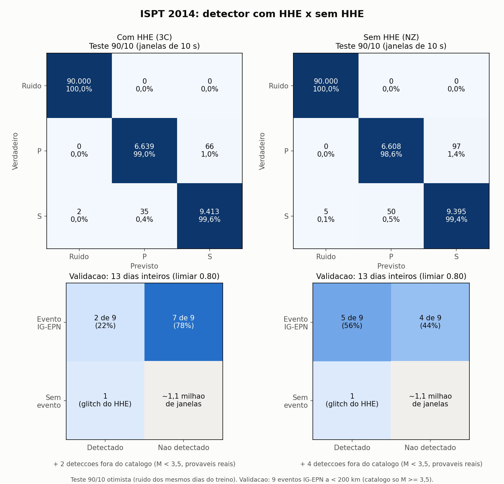
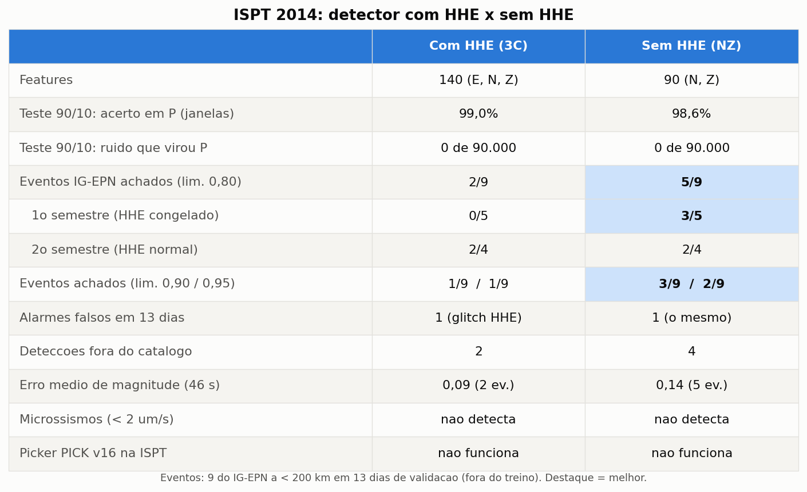
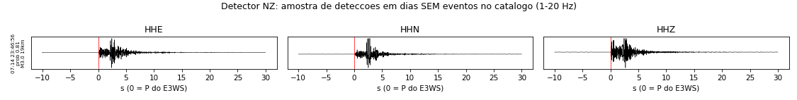
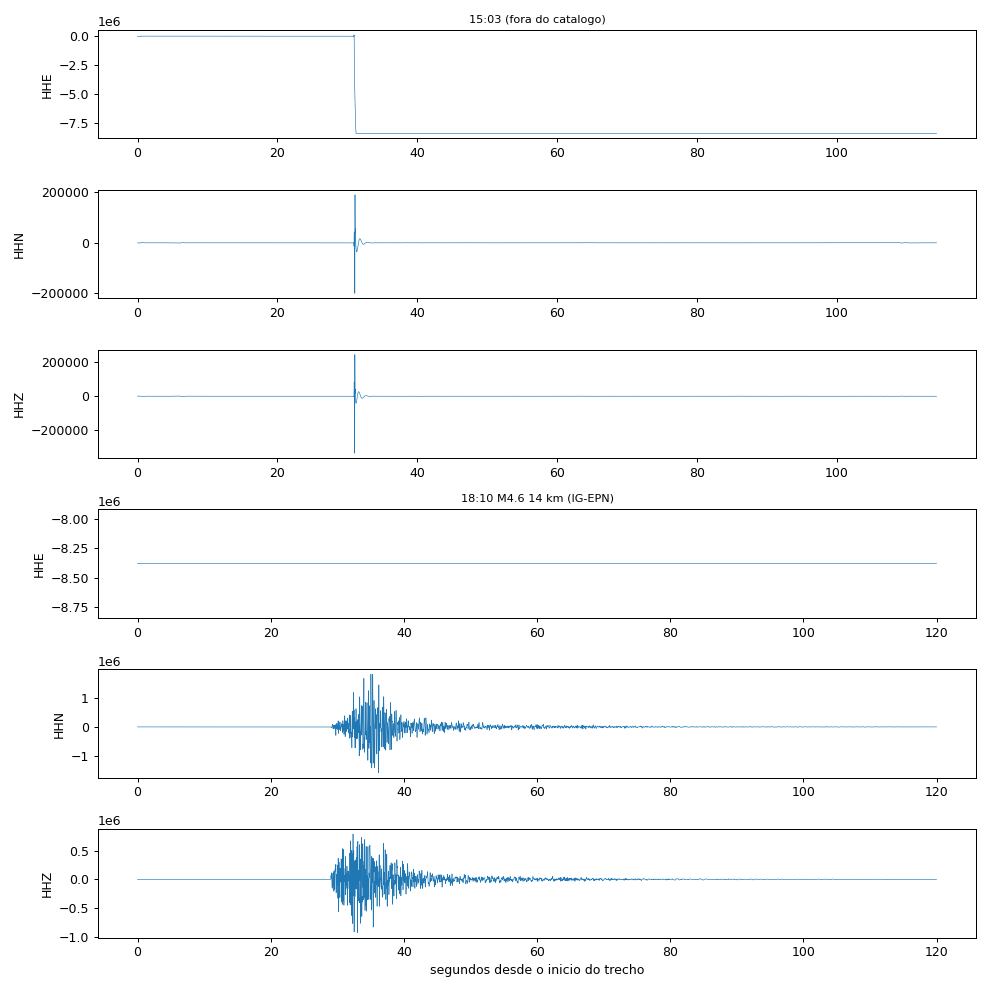

# E3WS detector for station ISPT (2014): training and validation

*Experiment 02 · Isla de la Plata, Ecuador · with HHE (3C) × without HHE (NZ) · 2026-11-23*

## 1. Summary

- Two detectors were trained for ISPT:
  - **3C**, with all 3 components;
  - **NZ**, with only N and Z.
- Both used noise from the whole of 2014 (24 days, ~1,029k windows) and the official `atr_eq`.
- In the 90/10 test both are nearly perfect: 0 of 90,000 noise windows became P. This test, however,
  is optimistic.
- In the validation on 13 full days outside the training set:
  - **NZ found 5 of 9 IG-EPN events**;
  - **3C found only 2 of 9**, and none in the first half of the year, when HHE was frozen (0/5).
- There was only 1 false alarm in 13 days, an HHE glitch, and it was the same for both detectors.
- **Proposal: use the NZ detector for 2014.**
- Two problems need discussion: the generic picker does not work at ISPT, and the detector does not
  see microearthquakes (section 6).

## 2. Context: the HHE channel in 2014

- From 2014-01-01 to 2014-07-08, the HHE channel at ISPT was frozen at −8,382,254 counts, close to
  the 24-bit limit, with occasional spikes.
- In frozen windows, the 45 features of the E component are NaN.
- Even in the first half of the year, there are short stretches where the channel comes back.

## 3. Training

### 3.1 Data

| Set | Source | Windows |
|---|---|---|
| Earthquakes (P and S) | official E3WS `atr_eq` (M ≥ 3), 21,778 earthquakes | 167,525 (P 70,193, S 97,332) |
| Noise | 24 days of 2014, 2 per month, randomly drawn; 13 with frozen HHE | 1,029,441 usable (557,944 with frozen HHE) |
| Noise used in the final model | sample of the set above (Pablo's baseline) | 900,000 |

- **Windows:** 10 s, with a 1 s step, data resampled to 100 Hz.
- **Preprocessing:** instrument response removed with the StationXML (to acceleration) and a
  1–7 Hz filter.
- **Event mask on the noise:** the one from `gen_catag` (recursive STA/LTA 60/240 s, ±60 s). It
  removed only 0.5 % of the windows.
- **Days excluded from the noise:** those with IG-EPN events within 300 km, with M ≥ 6.5
  teleseisms, or with incomplete data.

### 3.2 Model

- StandardScaler + XGBoost (`gpu_hist`; 6,000 trees, depth 4, learning rate 0.05; other
  hyperparameters as in E3WS).
- **3C:** 140 features (E, N, Z + 5 cross features), trained in 22.8 min.
- **NZ:** 90 features (N and Z only), trained in 11.1 min.
- Both trainings ran on an RTX 3050.

## 4. Results

*Figure 1. Top: 90/10 test (windows). Bottom: validation on 13 full days (events). True negatives
(TN) are not counted in the validation, because these are full days with ~1.1 million windows.
Figure labels are in Portuguese: Ruido = noise, Previsto = predicted, Verdadeiro = true,
Detectado = detected, Nao detectado = not detected, Sem evento = no event.*

### 4.1 90/10 test

- 10 % of the earthquakes and 90,000 noise windows were held out of training.
- Both models get ~99 % of P and S windows right, and no noise window becomes P.
- The test is **optimistic**, because the test noise comes from the same days as the training noise.

### 4.2 Validation on full days

- **Days:** 13 days not used in training. 6 are quiet (3 of them with frozen HHE) and 7 have
  IG-EPN events within 200 km.
- **Trigger:** the same as in `E3WS_rt.py`. It fires when the mean of the last 3 P probabilities
  reaches the threshold, and re-arms when the mean of the last 5 noise probabilities reaches 0.99.
- **Reference:** the IG-EPN catalog from Pablo's folder, which only contains M ≥ ~3.5.
- **Criterion:** an event counts as "found" if the E3WS P arrival falls between origin − 5 s and
  origin + dist/5.5 + 15 s.

| IG-EPN event (UTC) | M | Dist. km | Depth km | HHE | 3C | NZ |
|---|---|---|---|---|---|---|
| 2014-01-02 08:42 | 3.9 | 148 | 8 | frozen | – | **yes (0.95)** |
| 2014-01-05 16:29 | 3.7 | 184 | 63 | frozen | – | – |
| 2014-06-13 18:10 | 4.6 | 14 | 3 | frozen | – | **yes (1.00)** |
| 2014-06-13 19:16 | 3.8 | 11 | 7 | frozen | – | **yes (0.98)** |
| 2014-07-02 16:10 | 3.6 | 151 | 9 | frozen | – | – |
| 2014-07-18 12:08 | 4.1 | 108 | 6 | normal | – | – |
| 2014-08-01 10:05 | 3.9 | 112 | 13 | normal | yes (0.84) | yes (0.87) |
| 2014-09-05 05:38 | 3.6 | 104 | 49 | normal | – | – |
| 2014-09-05 20:50 | 3.9 | 64 | 10 | normal | yes (0.99) | yes (0.87) |
| **Total** | | | | | **2/9** | **5/9** |

*Table 1. Catalog events on the validation days and their P probabilities, with a threshold of
0.80. Both detectors missed the events more than 100 km away; two of these are deep (49 and 63 km).*

*Figure 2. Comparison of the two detectors (labels in Portuguese).*

### 4.3 Detections outside the catalog and false alarm

- **Quiet days:** 1 detection in 6 days (07-14 23:46:56), by both detectors.
  - P and S are clear, with S−P ≈ 2.3 s (~19 km), and E3WS estimated M3.0.
  - It is a real microearthquake (Figure 3).
- **2014-06-13, NZ only:** detections at 18:40 and 18:45 (M ~3.7, 15–24 km). They look like
  aftershocks of the M4.6, but they have not yet been checked on the seismogram.
- **Only false alarm: 2014-06-13 15:03:26, in both detectors.**
  - It is the moment when HHE freezes again (it jumps to −8.38 million counts).
  - At the same instant, a pulse appears on N and Z.
  - It is an instrument glitch, not an earthquake (Figure 4).

*Figure 3. The only NZ detection on quiet days (1–20 Hz; 0 = E3WS P arrival).*

*Figure 4. The 15:03 false alarm (top) × the 18:10 M4.6 (bottom), on 2014-06-13. HHE is shown in
raw counts; N and Z are filtered at 1–20 Hz.*

### 4.4 Source parameters (46 s of P)

| Event | Catalog M | E3WS M | Catalog dist. (km) | E3WS dist. (km) |
|---|---|---|---|---|
| 2014-01-02 08:42 | 3.9 | 4.09 | 148 | 111 |
| 2014-06-13 18:10 | 4.6 | 4.51 | 14 | 19 |
| 2014-06-13 19:16 | 3.8 | 4.05 | 11 | 25 |
| 2014-08-01 10:05 | 3.9 | 4.04 | 112 | 114 |
| 2014-09-05 20:50 | 3.9 | 3.87 | 64 | 77 |

*Table 2. Values from the NZ detector. Magnitude is within ±0.25 of the catalog and distance is
reasonable. Back-azimuth in the first half of the year is not physically meaningful, because it
depends on the E component.*

## 5. Why the detector with HHE fails

- In training, every window with a frozen E (NaN) was noise, while the `atr_eq` earthquakes have
  all 3 components.
- So the 3C detector learned the shortcut **"frozen E ⇒ noise"**. In the first half of the year,
  its P probability stays ≤ 0.001, even for the M4.6 at 14 km from the station.
- Without E (the NZ detector), the shortcut disappears. In the second half of the year, NZ performs
  the same as 3C.

## 6. Problems found (for discussion)

### 6.1 The generic picker does not work at ISPT

The test used `PICK_CLF_..._v16` (StationXML, `pb_inst=True`, the same configuration as
`E3WS_Ecuador.py`) on the 8 s ending at the triggering window. The table shows the maximum P
probability:

| Case | Real HHE | E = copy of N | Frozen E |
|---|---|---|---|
| 09-05 20:50, M3.9, 64 km (normal HHE) | 0.003 | 0.003 | 0.977 |
| 08-01 10:05, M3.9, 112 km (normal HHE) | 0.002 | 0.001 | 0.993 |
| 06-13 18:10, M4.6, 14 km (E already frozen) | 0.990 | 0.001 | 0.990 |

- With real data, the picker gives ~0.001, even for clear earthquakes.
- It only gives ~0.99 when E is frozen (NaN features), and that is an artifact.
- As a result, the P arrival becomes the maximum of an almost flat curve.
- Even so, magnitude and distance came out reasonable.

### 6.2 Low sensitivity to microearthquakes

- The trigger does not get stuck: the re-arm condition holds in 99–100 % of the windows.
- The detector simply gives P ≈ 0 to small events.
- Example from day 195, with the largest classic STA/LTA triggers (1,592 triggers that day):

| Trigger | Z amplitude | P prob. (3C) | P prob. (NZ) |
|---|---|---|---|
| 23:46:56 | 13.8 µm/s | 0.998 | 0.999 |
| 15:24:17 | 1.3 µm/s | 0.167 | 0.098 |
| 20:46:29 | 2.3 µm/s | 0.041 | 0.039 |
| other 12 | 0.2–0.7 µm/s | ≤ 0.08 | ≤ 0.005 |

- **Likely causes:**
  - the `atr_eq` only contains M ≥ 3 earthquakes;
  - the `gen_catag` mask leaves microearthquakes inside the noise, so the detector learns that they
    are noise.
- **Consequence:** the detector works for events of ~M3 and above, but not for counting the
  island's microseismicity.

## 7. Questions for Pablo

- Use NZ for 2014 (and 3C for the years when HHE is good)?
- **Picker:**
  - did it work at SALI?
  - Is it worth training a picker for ISPT, or should we use a classic pick (AIC/STA-LTA) inside
    the triggering window?
- **Sensitivity — which path?**
  - accept completeness at ~M3;
  - retrain with the strict mask (STA/LTA 0.5/10 s, which removes microearthquakes from the noise);
  - add small events to the `atr_eq`;
  - complement with another method.
- **Data I need:**
  - the 2014 IG-EPN catalog with all magnitudes (the current copy only has M ≥ 3.5);
  - the GNSS moment-rate time series.

---
*Scripts, logs and the step-by-step guide to reproduce everything are in the `rickalves/E3WS`
repository, branch `experimentos`, folder `experimentos/exp02_ispt_2014` (GUIA.md, sections D5–D7,
in Portuguese). Portuguese versions: `RELATORIO_treino_validacao_ISPT2014.md` and `.docx`.*
